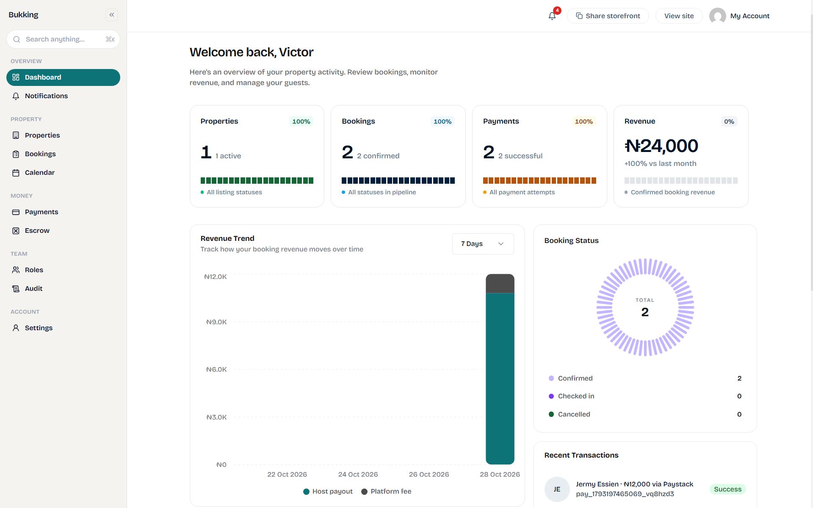
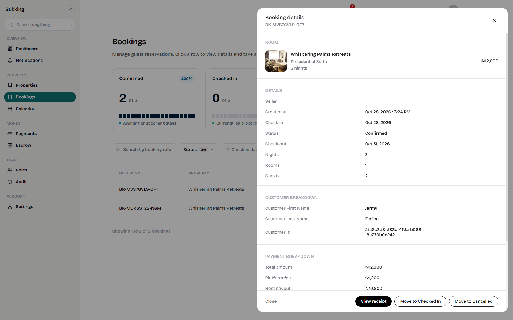
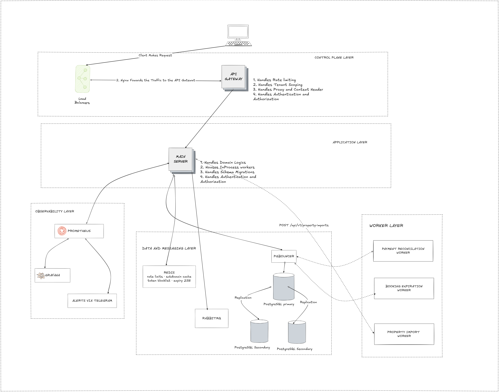
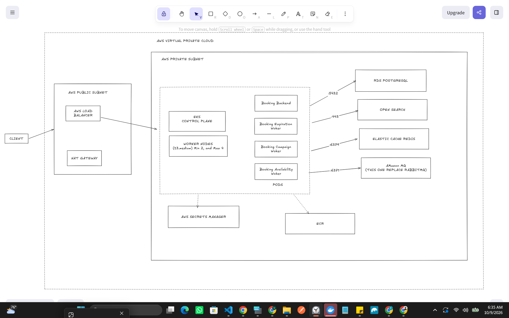

# Bukking

Taking short-stay bookings online can be messy: rooms get double-booked, payments are hard to track, one bad actor can hammer the whole platform, and you can’t always kick a stolen session offline. Most hosts end up using several tools together. Bukking is built so those pieces work as one system.

**Bukking** is a multi-tenant booking marketplace for shortlets, hotels, and guesthouses.

**Live:** [https://bukkings.space](https://bukkings.space)  
**Stack:** Node.js, TypeScript, PostgreSQL, Redis, RabbitMQ, Docker Compose, Terraform, Kubernetes, Helm, GitHub Actions, Grafana, Prometheus, Loki, Promtail

---

## Try it

1. Open the [live demo](https://bukkings.space).
2. Browse as a guest, or create a host account (email OTP).
3. Host path: onboarding → properties → bookings and payouts in the dashboard.

Local: API `4000` · gateway `8080` · frontend `5173`.






---

## Hard problems this system is built around

These are the few parts the system actually depends on — not a feature list.

### 1. Idempotency

Payment init, webhooks, and other side-effecting writes must not double-apply when the client retries or the gateway delivers twice. Idempotency keys and state transitions are part of the money and booking paths so “submit again” does not create a second charge or a second booking transition.

### 2. Transactional outbox

Domain commits and “tell the rest of the system” are not two independent hopes. Events are written in the same database transaction as the business row, then published asynchronously (outbox poller / workers). That keeps booking confirmed, notifications, audit, and downstream consumers aligned when the process crashes mid-request.

### 3. Tenant-aware rate limiting

Abuse is not only global. Limits are matched by identity (user vs IP), route, and tenant/user type at the gateway, with Redis-backed limiters and fail-closed behavior on sensitive auth routes when Redis is down. One noisy tenant or scraper should not define the experience for everyone.

### 4. Reclaim / recovery workflows

Holds expire, unpaid `pending_payment` bookings time out, availability locks are swept, and reconciliation passes close gaps the happy path missed. The system assumes partial failure: reclaim is the design, not an afterthought.

### 5. Session-based auth (revocable)

Access is not “JWT until expiry only.” Login creates a durable session (device metadata, lifecycle in Postgres) with a hot-path version/revocation check (Redis). Logout, logout-all, admin revoke, and password change invalidate sessions without waiting for token TTL. Idle and multi-device behavior are part of the model.

### 6. Double-entry ledger

Money movement is recorded as real debit/credit entries (payment received, escrow hold/release, refund, chargeback paths), not only a status flag on a payment row. Balances and clawback/refund decisions can be reasoned about from the ledger, scoped correctly (e.g. per booking, not an unrelated aggregate).

### 7. Observability you can operate

The system is instrumented to answer “is it broken?” and “where?” without SSHing into a box first.

- **Metrics (Prometheus):** HTTP RED, domain ops (`measureAuthOp`, `measureBookingOp`, `measurePaymentOp`, …), DB query timing, cache hit/miss, worker job success/duration. Low-cardinality labels only (operation, status, route — not user or booking IDs).
- **Workers expose `/metrics`** on their own ports so background reclaim, import, and outbox work is visible, not only the API.
- **Grafana:** overview (RED), critical domains, workers, database pool/query latency, and deeper KPI boards (confirm success rate, auth funnel, payment path).
- **Telegram alerts:** health down, elevated 5xx, auth/payment error rates, worker job failures, DB pool saturation — to a phone, not only a dashboard tab.
- **k6 SLIs (repo-root `k6/`):** modular load suite aligned to the same critical and hot paths the product depends on:
  - `k6/critical/` — reserve, pay init, webhook confirm/replay, cancel/refund, escrow release, login/session, refresh, logout, tenant-scoped writes, idempotent POSTs
  - `k6/hot/` — search, detail, availability calendar, concurrent reserve, login storm, `/me`, dashboard stats, host lists, gateway rate limit, health/metrics
  - `k6/overlap/` — journeys that are both critical and hot (full money path outline, concurrent reserves, login storm, webhook replay, refresh after revoke)
  - Shared `k6/lib/` for config, checks, and threshold presets  
  Run via root npm scripts (see **Run locally**). Thresholds track the same latency and error budgets the alerts use.

If it cannot be measured, load-tested, or paged, it is not fully “in production” for this codebase.

### 8. Tests as a product constraint

The pyramid is intentional: **unit-heavy on load-bearing domains**, integration against real Postgres, load at the monorepo edge.

| Tier | Where | What it locks |
|------|--------|----------------|
| **Unit** | Service / backend `src/__tests__/unit/` | Booking status × event table, ledger sum-to-zero style invariants, idempotency replay/conflict, outbox process-once, session revoke + version bump, worker process-once pattern |
| **Integration** | `backend` (and extracted services as they grow) | Testcontainers Postgres, real migrations, HTTP routing; includes RLS checks under `booking_app` for critical writes (e.g. `room_types`) where provisioned |
| **Load** | Repo-root `k6/` only | Critical / hot / overlap modules above — not buried inside one service |

Unit tests target repositories and services (infra mocked). Integration applies the real migration set and exercises routing end to end. Orchestration sagas (e.g. booking-payment) have unit coverage next to `orchestration-service`.

Coverage is still partial across all domains. Not every table is RLS-asserted in CI; money path, outbox, session revoke, ledger, and idempotency are the priority seams. That gap is tracked, not ignored.

### 9. Feature flags (progressive delivery of behavior)

Unfinished or risky behavior must not require a long-lived branch or a full rollback of the binary. Flags live in Redis, evaluated in-process (`FeatureFlagEngine`), refreshed over a dedicated pub/sub subscriber, and enforced on the server (middleware and service checks). Frontends may read flag state for UX; the API remains the source of truth.

What this unlocks:

- **Kill switches** for money and webhook paths without redeploying
- **Percentage / allowlist rollouts** (stable hash of user or tenant) so a change can hit 5% of traffic before 100%
- **Decoupling deploy from release:** ship dark code on trunk, turn behavior on when metrics and canaries look safe

---

## What sits on top of the above

Availability calendars and locks, escrow release to hosts, RBAC, subdomain storefronts (`sellername.bukkings.space`), CSV import, host notifications, and audit trails all depend on the problems above. Custom apex domains are designed (Caddy + TLS); not live on the current host edge.

**Multi-tenant data plane:** `FORCE ROW LEVEL SECURITY` + `SET LOCAL app.current_tenant_id` under PgBouncer transaction pooling. Policies exist; runtime still uses `postgres` via PgBouncer in places, so RLS is **not** end-to-end enforced on every connection yet. Intended roles: `booking_app` (RLS) and `booking_worker` (`BYPASSRLS`). Integration tests can exercise `booking_app` where roles are provisioned in the test DB.

---

## Shape of the system



```
| Process / package           | Role |
| --------------------------- | ---- |
| **backend** `:4000`         | API + in-process workers (sweep, expiry/reclaim, import, notifications, campaigns, audit/outbox consumers) where not yet extracted |
| **gateway** `:8080`         | Rate limiting, subdomain → tenant |
| **frontend** `:5173`        | Guest marketplace + host dashboard |
| **orchestration-service**   | Booking-payment saga orchestration |
| **booking-service**         | Booking domain extraction (in progress) |
| **payment-service**         | Payment domain extraction (in progress) |
| **ledger-service**          | Ledger domain extraction (in progress) |
| **packages/\*-worker**      | Availability, campaign, CSV import, seller notification, audit, booking expiry |
```

Workers remain **in-process** on the API host for Railway cost limits where not split; separate-container layout remains on `archive/separate-worker-containers`. Search runs in Postgres (`tsvector`, `pg_trgm`, `earthdistance`) after dropping Elasticsearch.

---

## Tradeoffs

```
| Choice                                     | Why                                 | Cost                                                     |
| ------------------------------------------ | ----------------------------------- | -------------------------------------------------------- |
| Outbox over sync dual-write                | Crash-safe side effects             | Poller lag; at-least-once consumers must be idempotent   |
| Session version in Redis + row in Postgres | Fast revoke + queryable device list | Two stores to keep coherent on revoke                    |
| Tenant/route rate limits at gateway        | Fairness and auth abuse control     | Redis dependency; fail-closed on auth when Redis is down |
| Ledger + escrow statuses                   | Auditable money                     | More write path complexity than a single status enum     |
| In-process workers                         | One deploy unit on a budget         | Shared blast radius with API                             |
| Boot idempotent SQL migrations             | Fast solo iteration                 | No version table / downs yet                             |
| k6 at monorepo root                        | Load spans gateway + services       | Needs running stack + env tokens/fixtures                |
```

---

## Run locally

```bash
npm install
npm run docker:up:build
```

Windows (Puppeteer): `PUPPETEER_SKIP_DOWNLOAD=true npm install`.

### Unit and integration

```bash
npm run test
npm run test:integration
npm run test:orchestration
```

Integration uses Testcontainers Postgres and real migrations. Prefer money path, outbox, session revoke, ledger, and idempotency when extending suites. RLS under `booking_app` is asserted only where the test DB provisions that role.

### Load (k6)

Requires a running stack (gateway) and env such as `BASE_URL`, `GUEST_TOKEN`, `HOST_TOKEN`, `PROPERTY_ID`, `ROOM_TYPE_ID` (see `k6/README.md`).

```bash
# Prefer overlap / smoke first
npm run test:k6:smoke
npm run test:k6:critical:reserve
npm run test:k6:critical:payment
npm run test:k6:hot:health

# Full bands
npm run test:k6:critical
npm run test:k6:hot
npm run test:k6
```

Individual modules: `npm run test:k6:critical:*` and `npm run test:k6:hot:*` (see root `package.json`).

---

## Docs

```
|               |                        |
| ------------- | ---------------------- |
| API contracts | `docs/api-contracts/`  |
| ADRs          | `docs/ADR-*.md`        |
| Runbooks      | `docs/runbooks/`       |
| Workers       | `packages/*/README.md` |
| Load suite    | `k6/README.md`         |
```

---

## Not claimed

- RLS enforced on every production connection
- Perfect once-only delivery without consumer idempotency
- Complete automated coverage of every domain
- Alerting with zero false positives
- k6 green without seeded inventory and valid tokens
